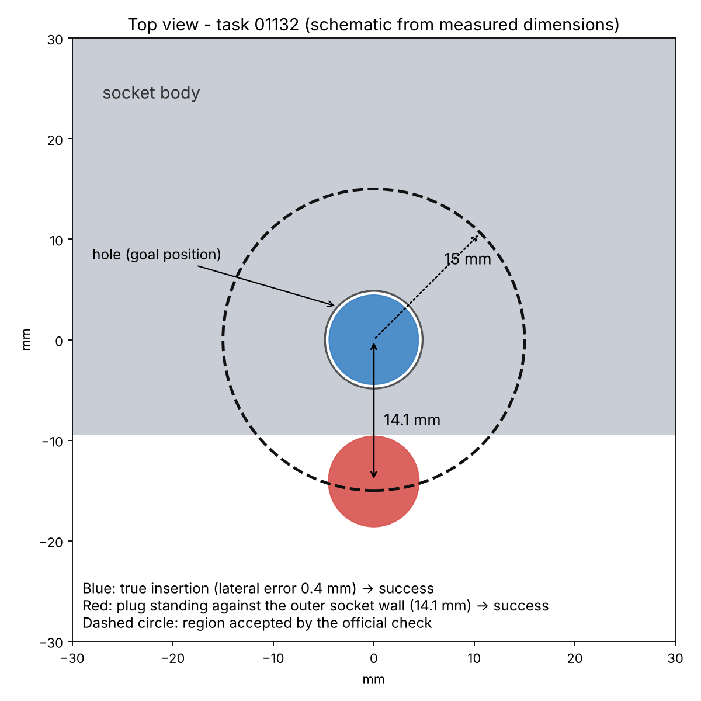
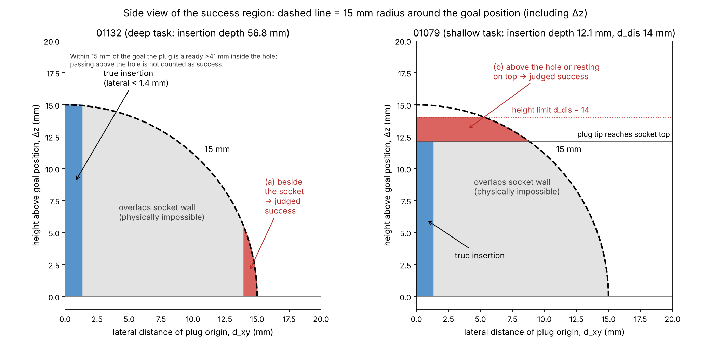

# 2. The Official Success Check Is a 15 mm Hemisphere for Every Task

Notation: **[verified]** = confirmed from code or by calculation; **[inferred]** = reasoning that has not been verified.
Code examined: SRSA commit `2bed3f7` (GitHub NVlabs/SRSA) and Isaac Lab tag `v2.3.0`.

## 2.1 Code path [verified]

1. **Environment registration** (SRSA `tasks/direct/srsa/__init__.py`)
   - `Assembly-Direct(-Sil)-v0` is Isaac Lab's `AssemblyEnv`.
   - `Assembly-Sparse(-Sil)-v0` is SRSA's `AssemblySparseEnv(AssemblyEnv)`.
   - All four use `AssemblyEnvCfg`.
2. **A single task class.** `AssemblyEnvCfg.tasks = {"insertion": Insertion()}`. Tasks differ only in `assembly_id`, which selects the asset path.
3. **What `run_w_id.py` changes** (SRSA and Isaac Lab alike). It edits only four lines of the configuration file: `assembly_id`, `if_sbc`, `if_logging_eval` and `eval_filename`. It does not touch `close_error_thresh`, `num_keypoints` or `keypoint_scale`.
4. **Success check call.** Both `AssemblyEnv._get_rewards` and `AssemblySparseEnv._get_rewards` call `check_plug_inserted_in_socket(held_pos, fixed_pos, disassembly_dists, keypoints_held, keypoints_fixed, close_error_thresh, ...)`.
5. **Parameters**
   - `close_error_thresh = 0.015` (`Insertion`)
   - `num_keypoints = 4` and `keypoint_scale = 0.15` (`AssemblyTask` defaults)
   - `success_height_thresh = 0.003` (the IndustReal value) remains in the configuration but is never read by the AutoMate code.
6. **Keypoints**
   - They lie on the z-axis at (0, 0, −75 / −25 / +25 / +75 mm).
   - Because `held_base_pos_local = 0` and `fixed_success_pos_local = 0`, the plug keypoints are defined relative to the plug origin and orientation, and the socket keypoints relative to the socket origin and orientation.
7. **Origins.** The SDF reward code states: "In source OBJ files, when plug and socket are assembled, their poses are identical." The socket origin is therefore the goal position of the plug.
8. **Socket orientation.** Initial-pose randomization changes yaw only (`fixed_orn_euler[:, 0:2] = 0.0`), so the socket axis is always vertical.

## 2.2 Proof [verified]

Notation:
- Δ = p − s (plug origin minus socket origin)
- o_m = (0, 0, L(m/3 − 1/2)), m = 0, …, 3, L = 0.15 m, so that Σ o_m = 0

The keypoint error is k_m − k_m* = Δ + (R_p − R_s) o_m. By the triangle inequality and Σ o_m = 0,

  mean_m ‖Δ + (R_p − R_s) o_m‖ ≥ ‖mean_m(Δ + (R_p − R_s) o_m)‖ = ‖Δ‖.

- **Consequence.** Success implies ‖p − s‖ < 15 mm and 0 < Δz < d_dis. The success region therefore always lies **inside** a hemisphere of radius 15 mm centred on the goal position, cut at height d_dis.
- **No tilt.** If R_p o_m = R_s o_m (the relative rotation is about the insertion axis only), equality holds, and the success region is exactly this hemisphere.
- **With tilt.** The region shrinks inside the hemisphere. With coincident origins, tilt alone produces the following mean keypoint errors:

  | Tilt | Mean keypoint error |
  |---|---|
  | 1° | 0.87 mm |
  | 2° | 1.75 mm |
  | 5° | 4.36 mm |
  | 10° | 8.72 mm |

- **Per-task differences.** No mesh or part dimension enters the check. The 15 mm radius is therefore identical for all 100 tasks. Only the height limit d_dis (from `disassembly_dist.json`, downloaded from Nucleus at run time) differs between tasks.

## 2.3 Two cases accepted by this check

| Case | Condition | Example |
|---|---|---|
| (a) Beside the socket | If socket outer radius + plug radius < 15 mm, a plug standing next to the socket body is still inside the hemisphere. | 01132: 9.4 + 4.5 = 13.9 mm. Observed keypoint errors are 14.1–14.9 mm. |
| (b) Shallow tasks | If D_ins ≤ Δz < min(d_dis, 15 mm), the check passes even though the plug tip is above the socket top. | 01079: d_dis = 14 mm, insertion depth D_ins = 12.1 mm |

## 2.4 Numerical verification [verified]

- **Random samples.** `tools/verify_hemisphere.py` tests 200,000 random samples (translation σ = 10 mm, random socket orientation, relative rotation 0–0.5 rad).
  - The minimum of (mean keypoint error − ‖p − s‖) is 1.3 × 10⁻¹³ m. This is non-negative up to floating-point error.
  - With rotation about the axis only, the maximum absolute difference is 1.4 × 10⁻¹⁷ m.
- **Recorded evaluations.** In 257 recorded evaluations, we recomputed the check from the logged Δz, lateral distance and keypoint error. It matched the environment's own result for every environment instance; there were no mismatches ([docs/03](03_strict_criterion.md)).

## 2.5 Limitations

- The d_dis values are not included in this repository. They are in `disassembly_dist.json`, which is downloaded from Nucleus.
- The keypoint definition assumes that the plug and socket axes are the local z-axes of the assets. We confirmed this only indirectly: through the SDF comment, and through the overlap of the assembled meshes computed in `tools/strict_geom.py`.
