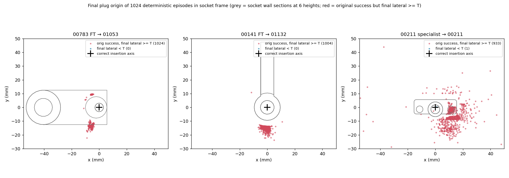

# 3. A Strict Insertion Criterion and Re-evaluation

Notation: **[measured]** = confirmed from outputs, code or meshes; **[inferred]** = reasoning that has not been verified.

## 3.1 Definition

During evaluation, the following values are recorded at every step (`tools/strict_play.py`; the success check itself is unchanged):
- **Δz**: height of the plug origin minus height of the socket origin. It is 0 when fully assembled.
- **d_xy**: lateral distance between the plug origin and the socket origin.

```
strict success at step t   = official check(t) AND d_xy(t) < T AND Δz(t) < D_ins
strict success of episode  = the condition above holds at any step of the episode (5 s, 74 steps)
```

T and D_ins are fixed per-task values. They are precomputed from the part meshes (`tools/strict_geom.py` → `data/strict_geom.json`).

### Lateral threshold T = clearance c + 1 mm

1. Place the plug and socket meshes in the assembled state, with coincident origins and the axis along z.
2. Sample 400,000 points on each mesh surface, with density proportional to area.
3. Take the height range where the two parts overlap, excluding 1 mm at each end. Slice it every 0.5 mm, using a slab of ±0.25 mm per slice.
4. At each height z, compute g(z): the minimum 2D distance between any plug surface point and its nearest socket surface point. g(z) is the tightest gap between the two parts at that height.
5. Take the 10th percentile of g(z) over all heights as the clearance c. This is the gap at the tightest-fitting section.
   - The median is not used. For sockets with a wide upper cavity, such as 00638 and 00426, the median would equal the cavity width.
6. Add a margin of 1 mm for contact penetration and mesh approximation. This margin is an estimate [inferred]; its effect is examined in the sensitivity analysis below.

For the evaluated tasks, T ranges from 1.34 to 1.63 mm.

### Depth threshold D_ins (insertion depth)

```
D_ins = (height of the socket top near the axis) − (height of the lowest plug point)   [assembled frame]
near the axis = socket surface points within (maximum plug radius + 2 mm) of the axis
```

- Δz < D_ins means that the lowest point of the plug is below the socket top.
- Example: for 01079, D_ins = 12.1 mm and the official height limit is d_dis = 14 mm. Any Δz between 12.1 and 14 mm therefore passes the official check but fails the strict criterion.

### Tools

- `python tools/strict_score.py <run>.npz` computes both success rates from one recording.
- A training environment that uses this criterion as its reward is provided in `tools/srsa_strict/` (see [docs/04](04_reward_finetuning.md)).

## 3.2 Re-evaluation protocol

**Settings.**
- Deterministic policy, 1024 environments, 5 s episodes.
- `fixed_asset_z_offset` = 0.1435, the Isaac Lab v2.3.0 default.

**257 evaluations, covering:**
- fine-tuned and from-scratch checkpoints for test tasks 01132, 01053 and 01102;
- self-trained specialists on their own tasks;
- zero-shot transfer of released and self-trained policies to the test tasks;
- all remaining evaluations of any task in which a first pass found more than 5% false successes.

## 3.3 Validation of the criterion [measured]

**Reproducing the official check.** We recomputed the per-step official check from the logged values. It matched the environment's result for every environment instance, with zero mismatches across all 257 evaluations.

**Policies that truly insert are not penalised.** The table shows converged specialists trained from scratch, evaluated on their own tasks.

| Policy | Official → strict |
|---|---|
| 00638 | 0.989 → 0.989 |
| 00141 | 0.916 → 0.896 |
| 01053 | 0.999 → 0.993 |
| 01102 | 1.000 → 0.955 |
| 01132 | 0.891 → 0.891 |

Among strictly successful episodes, the median final lateral distance is 0.4–0.8 mm.

**Exception: the self-trained 00211 specialist (0.912 → 0.000).**
- The socket has three holes, and the policy ends 9–12 mm away from the correct one.
- Other policies do pass the strict criterion on this task (0.705 and 0.818). The criterion is therefore not impossible to meet here.

**Sensitivity.** Setting the lateral threshold to 1, 2, 3 or 5 mm does not change any conclusion. The false successes in 01132 sit about 14 mm from the axis, so they do not depend on the threshold at all.

## 3.4 Results [measured]

**Share of false successes.**
- Across the 243 evaluations with a non-zero official success rate, on average **56% of official successes fail the strict criterion**.
- Pooled over all 257 evaluations, the share is 54%.
- Most of these are lateral misalignment (0.54); hovering above the socket accounts for 0.02.

**Two failure modes** (`figs/strict_false_positions.png`):
- **Standing beside the outer socket wall** (fine-tuning on 01053 and 01132).
  - The plug stands outside the socket body, at the height of a correct insertion: 01053 at y ≈ −12 mm, 01132 at y ≈ −14 mm.
  - Mesh penetration is zero.
  - The keypoint error is 14.4–14.9 mm, just below the 15 mm tolerance.
- **Resting on top without alignment** (shallow tasks such as 01036 and 01079): lateral distance 1.5–4 mm, with Δz ≈ D_ins.



### Per-task summary

| Task | T / D_ins (mm) | Evaluations | Mean official | Mean strict |
|---|---|---|---|---|
| 00141 | 1.44 / 29.2 | 1 | 0.916 | 0.896 |
| 00211 | 1.41 / 17.6 | 11 | 0.349 | 0.146 |
| 00638 | 1.34 / 33.4 | 1 | 0.989 | 0.989 |
| 01036 | 1.63 / 10.3 | 9 | 0.620 | 0.086 |
| 01041 | 1.46 / 9.0 | 9 | 0.967 | 0.436 |
| 01053 | 1.44 / 21.8 | 50 | 0.525 | 0.269 |
| 01079 | 1.34 / 12.1 | 38 | 0.794 | 0.357 |
| 01092 | 1.42 / 12.7 | 9 | 0.922 | 0.496 |
| 01102 | 1.42 / 13.1 | 50 | 0.770 | 0.286 |
| 01125 | 1.52 / 7.1 | 9 | 0.930 | 0.363 |
| 01129 | 1.40 / 6.1 | 11 | 0.996 | 0.510 |
| 01132 | 1.37 / 56.8 | 50 | 0.304 | 0.145 |
| 01136 | 1.46 / 11.2 | 9 | 0.975 | 0.670 |

Per-evaluation raw data is in `data/strict_results.tsv`. The main columns are:

| Column | Meaning |
|---|---|
| `orig` | official success rate |
| `strict` | strict success rate |
| `s1`–`s5` | strict success rate with a lateral threshold of 1, 2, 3 or 5 mm |
| `false_ratio` | share of official successes that fail the strict criterion |
| `recompute_mismatch` | number of mismatches when the official check is recomputed |

### Cause: the SRSA sparse reward is the official check itself [verified]

- SRSA's `assembly_sparse_env.py` sets `ep_succeeded = ep_succeeded OR curr_successes` and `rew = ep_succeeded`. Sparse fine-tuning therefore directly optimises the official check.
- Specialists trained from scratch with the AutoMate dense reward (keypoint and SDF distance terms) have nearly identical official and strict success rates.

## 3.5 Limitations

- d_xy uses only the distance between origins. Tilted jamming and partial insertion are not judged separately.
- The 1 mm margin and the "maximum radius + 2 mm" neighbourhood are design choices, not measured quantities.
- For some non-cylindrical parts the computed values are implausible, for example a clearance of 16.7 mm for 00117 and D_ins = 2.3 mm for 00133. The criterion has been validated by evaluation on 13 tasks.
- Video inspection was performed only for 01132. The other tasks were judged from recorded poses and the meshes.
- Each evaluation is a single deterministic run.
