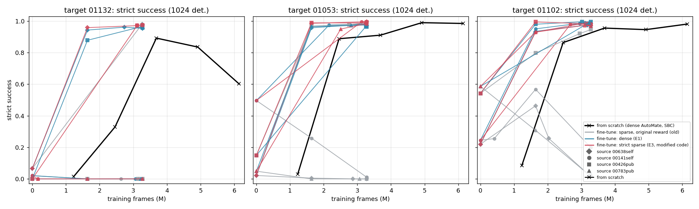
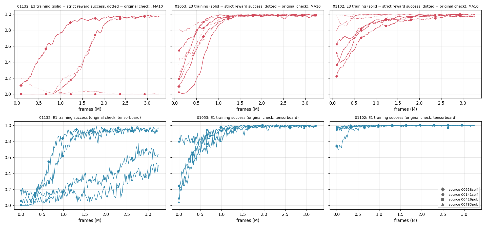
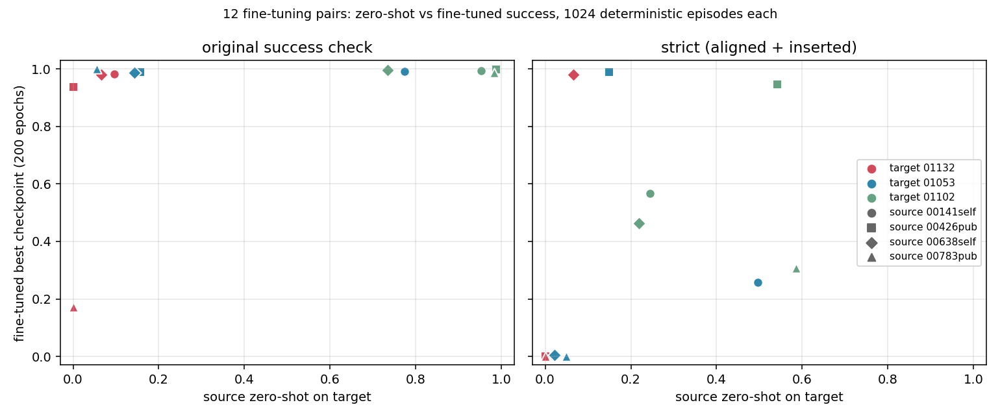

# 4. SRSA Fine-tuning under Different Rewards (Strict Criterion)

Notation: **[measured]** = confirmed from run outputs or code; **[inferred]** = reasoning that has not been verified. All conclusions use the strict criterion ([docs/03](03_strict_criterion.md)).

## 4.1 Question

Does SRSA fine-tuning with the official sparse reward learn true insertion? If it does not, is the benefit of transfer recovered when the reward is changed?

## 4.2 Conditions

| Condition | Reward | Code |
|---|---|---|
| Original sparse | Official check `ep_succeeded`: 1 if successful at any step of the episode | Unmodified SRSA (`--sparse --sil --no_sbc`) |
| E1: dense | Per step: SDF reward + disassembly-trajectory imitation (soft-DTW) + 1 when the official check passes | Unmodified SRSA without `--sparse` (`Assembly-Direct-Sil-v0`) |
| E3: strict sparse | Same form as the original sparse reward; only the success definition is replaced by the strict criterion | **Modified code:** `tools/srsa_strict/`, a separate subclassed environment; the original files are unchanged |

**Common settings.**
- 12 pairs: sources 00638 and 00141 (self-trained) and 00426 and 00783 (released), each fine-tuned on targets 01132, 01053 and 01102.
- 128 environments, 200 epochs (3.28 M frames), seed 0, `--load_mode actor`, 5 s episodes.
- Self-imitation learning (SIL) on; curriculum (SBC) off.

**Evaluation.** Checkpoints at epoch 100 (1.64 M frames), epoch 200 (3.28 M frames) and the best-reward checkpoint, each evaluated with 1024 deterministic episodes. Both official and strict success rates are recorded.

**Baseline: training from scratch.** A specialist for each target task, trained with the AutoMate dense reward and SBC. Values at matching frame counts are linearly interpolated between checkpoints [inferred].

## 4.3 Results [measured]

| Metric (strict) | Original sparse | E1: dense | E3: strict sparse |
|---|---|---|---|
| Best ≥ 0.9 | 3/12 | **10/12** | **10/12** |
| Above from-scratch (interpolated) at 3.28 M frames | 3/12 | **10/12** | **10/12** |
| Above from-scratch (interpolated) at 1.64 M frames | 4/11 | 7/9 | 6/8 |
| Best ≥ best of from-scratch | 2/12 | 6/12 | 7/12 |
| Wall-clock time per run (A100 40 GB, two runs per GPU) | — | 13.4–18.7 h | 5.7–7.3 h |

Some runs have no epoch-100 checkpoint, and these are excluded from the 1.64 M denominators. rl_games did not write the periodic epoch-100 checkpoint for them, and the cause has not been identified.

**Original sparse reward.**
- Under the official check, 11 of 12 pairs exceed 0.9. Under the strict criterion, only 3 do.
- In some pairs, fine-tuning reduced true insertion:

  | Pair | Zero-shot strict → fine-tuned strict |
  |---|---|
  | 00141 → 01053 | 0.496 → 0.011 |
  | 00783 → 01102 | 0.586 → 0.031 |

  The official success rate of these pairs stayed at 0.94–1.00. The policies appear to have learned an easier pose that the reward accepts, standing beside the socket [inferred; causality not tested].

**E1 and E3.**
- 10 of 12 pairs reach a strict success rate of at least 0.96, and exceed training from scratch at the same 3.28 M frames.
- Training from scratch first reaches strict 0.9 at 3.69 M frames for 01053 and 01102, and never reaches it for 01132 (best 0.892).
- Under E3, the learning curves reach strict 0.9 at 0.69–2.08 M frames.

**The same two pairs fail under both E1 and E3:** 01132 from 00141, and 01132 from 00783.
- Under E3, the 00783 run never produced a strict success in 200 epochs, so it received no learning signal.
- Under E1, these two pairs reach official success rates of 0.690 and 0.484. A plausible explanation is the +1 term for the official check in the dense reward [inferred].

**Adaptation from zero.** On 01132, source 00426 has a deterministic zero-shot success rate of 0 but still adapted, to 0.965 (E1) and 0.975 (E3).

## 4.4 Answer

- Fine-tuning with the official SRSA sparse reward appears successful under the official check. Under the strict criterion, it achieves true insertion in only 3 of 12 pairs.
- Replacing the reward restores the benefit of transfer. With either the dense reward (unmodified paper code) or a strict sparse reward (modified code), 10 of 12 pairs reach true insertion faster than training from scratch.
- The benefit lies mainly in speed. On 01053 and 01102, training from scratch also reaches 0.98–0.99 when run to completion.

## 4.5 Limitations

- One seed per pair.
- 128 environments × 200 epochs, smaller than the paper's setting (256 × 1000).
- The paper's dense setting is "identical to AutoMate" and includes the SBC curriculum. It was disabled here to match the sparse condition.
- E3 is not a reproduction condition, because the reward code was modified.
- Reward, curriculum and budget all differ from training from scratch, and values at matching frame counts are interpolated.
- Only two or three checkpoints per run were evaluated, so frame counts at which thresholds are first reached are coarse.
